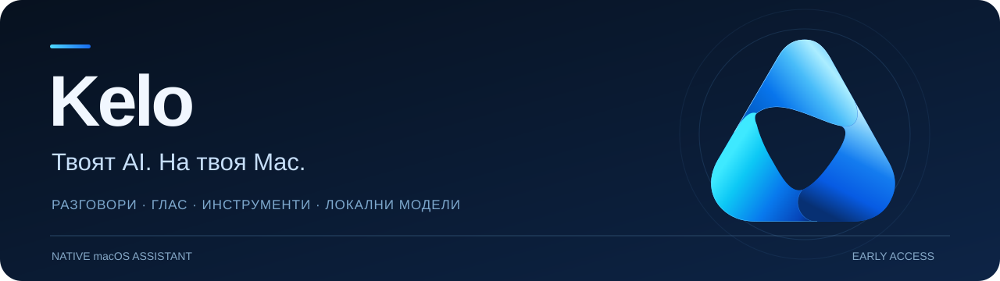
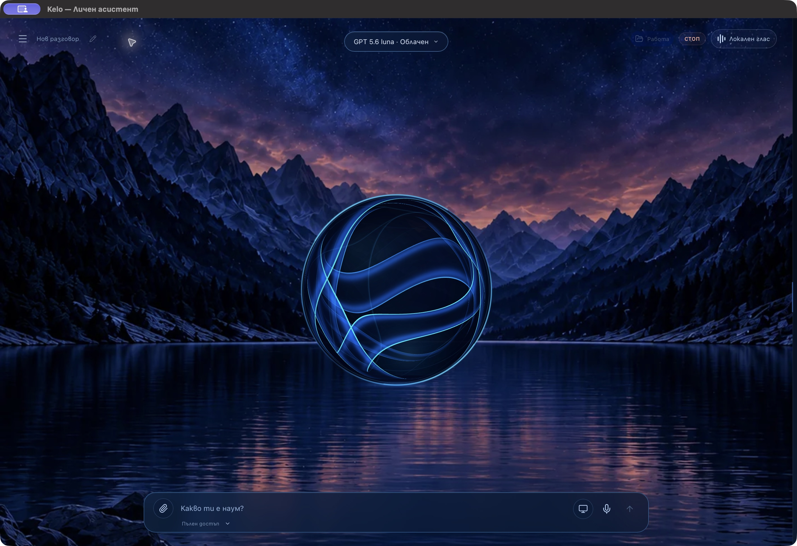

**Личен AI асистент с нативен Mac контрол, глас и избор между облачни и локални модели.**

[Последна версия](https://github.com/tsvetomirdimitrovv/kelo-releases/releases/latest) · [Как се инсталира](#инсталиране) · [Обновления](#обновления) · [Съобщи за проблем](https://github.com/tsvetomirdimitrovv/kelo-releases/issues)

---

## Един асистент за разговор и работа

Питай на български или английски, работи по файлове и проекти и възлагай конкретни действия на своя Mac. Избираш какъв модел да използва Kelo и какъв достъп да му дадеш.

| | |
| :--- | :--- |
| **Разговор с контекст** Чатове, проекти и запазени предпочитания остават при Kelo и при смяна на модела. | **Глас, когато ти е удобно** Gemini Live, локален гласов режим и диктовка в полето за съобщение. |
| **Действия на Mac** Отваряне на приложения и страници, наблюдение на прозорци и разрешени действия през нативните контроли. | **Работа с видими резултати** Файлове, източници, тестове и състояние на задачата в изглед „Работа“. |
| **Локални модели по избор** Предложения според хардуера и нуждите ти, изтегляне в приложението и доброволна локална проба. | **Твоят избор на доставчик** Gemini, OpenAI/Codex и инсталираните локални модели според наличните връзки и права. |

*Реален начален екран на приложението. Историята на разговорите е скрита; лични чатове и ключове не са публикувани.*

## Инсталиране

1. Изтегли **[Kelo.dmg](https://github.com/tsvetomirdimitrovv/kelo-releases/releases/latest/download/Kelo.dmg)** от последната версия.
2. Отвори DMG и плъзни **Kelo.app** в **Applications**.
3. Стартирай Kelo от Applications, Finder или Spotlight.
4. Премини през кратките първи стъпки. Можеш да пропуснеш незадължителните настройки и да ги отвориш по-късно.

**Изисквания:** Mac с Apple Silicon и macOS 26.2 или по-нова. Този пакет не поддържа Intel Mac, Windows или Linux.

> **За тази ранна версия:** приложението още няма Apple Developer ID нотарификация. macOS може да поиска потвърждение при първото отваряне. След опит за стартиране отвори **System Settings → Privacy & Security → Open Anyway**, ако тази възможност е налична, и потвърди само ако си изтеглил пакета от това хранилище. [Официални инструкции на Apple](https://support.apple.com/en-us/102445). Не е необходимо да изключваш защитата на Mac или да използваш Terminal.

## Първите няколко минути

- **За чат:** напиши въпрос и избери модел от горната част на разговора.
- **За глас:** отвори „Гласов разговор“. Микрофончето в полето е за диктовка на редактируем текст.
- **За Mac контрол:** разреши „Достъпност“, когато поискаш действие в приложение.
- **За екран:** сподели прозорец или разреши контекстното нативно наблюдение.
- **За локален модел:** избери подходящо предложение и натисни „Изтегли“. Моделите се изтеглят отделно и не увеличават първоначалния DMG.

Не е нужно да свързваш всички услуги. Облачните функции изискват съответния достъп; API ключовете имат собствена квота и не се покриват автоматично от потребителски абонамент за ChatGPT или Gemini. Някои акаунтни интеграции изискват отделно инсталиран официален клиент.

## Обновления

Kelo проверява за одобрени версии и може да ги изтегля автоматично. Инсталацията завършва при изход и повторно отваряне, след проверка на резервното копие. Текуща работа може да отложи обновлението.

За ръчна проверка използвай **Kelo → Провери за обновление…** или **Настройки → Общи → Обновления**. Автоматичното обновяване може да се изключи.

Обновленията се проверяват с отделен криптографски подпис на издателя. Това е различно от Apple нотарификацията. Чатовете, настройките, локалните модели и работните файлове остават извън приложението и се запазват при смяна на версията.

## Данни и достъп

Локалните модели обработват заявките на Mac. Когато използваш облачна услуга, необходимият текст, разрешен контекст, аудио или изображение се изпращат към съответния доставчик. Разрешенията за микрофон, екран, управление на приложения и работна папка са отделни.

Локалното активиране с „Кейло“ е незадължително. Аудиото в готовност не се изпраща към облак и не се записва непрекъснато. Калибрирането пази настройки, а не гласов биометричен шаблон.

## Какво да очакваш от Early Access

Kelo още се развива. Разпознаването на речта зависи от езика, микрофона и шума; конкретни сайтове и приложения могат да изискват допълнителен достъп или да не предоставят нужните контроли. Достъпът до облачен модел не гарантира отделно достъп до изображения или Live API. Пълна работа на произволен компютър и с всяко приложение не е обещана.

За промени и известни ограничения виж бележките към **[последната версия](https://github.com/tsvetomirdimitrovv/kelo-releases/releases/latest)**.

## Лицензи и изходен код на зависимости

Kelo включва компоненти с отворен код. Техните лицензи, бележки и съответният изходен код се предоставят с версията и в приложението. Виж **[THIRD_PARTY_NOTICES.md](THIRD_PARTY_NOTICES.md)** и архивите в Releases.

Това хранилище съдържа готовите версии, документацията и подписания канал за обновяване. Не съдържа потребителски бази данни, API ключове или лични работни папки.

---

**Kelo · The Keystone**  
Един асистент. Твоят избор как да работиш.

